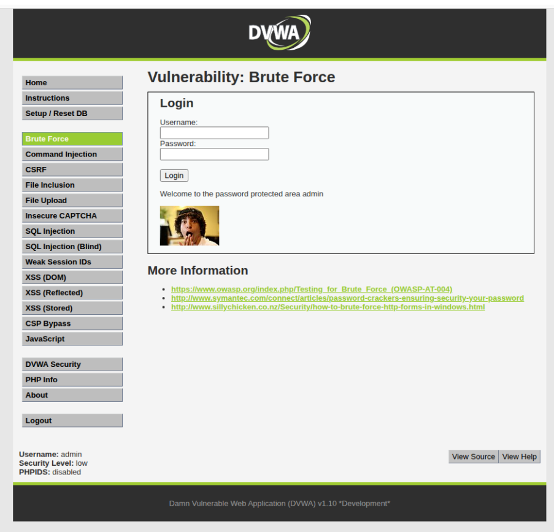
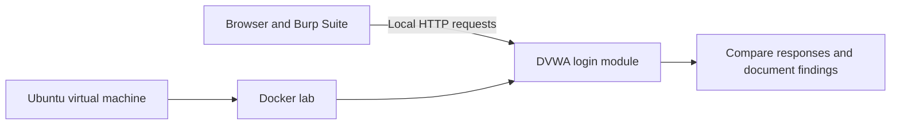

# DVWA Authentication Security Lab

**An Ubuntu and Docker lab exploring how weak login protections enable repeated password guessing.**

This portfolio case study presents my contribution to a group web application security assessment for **NET3034 Ethical Hacking and Countermeasures Fundamentals**. I completed the full Part 1 lab environment setup and the DVWA brute-force login assessment.

[Case study](docs/CASE_STUDY.md) · [Evidence](docs/EVIDENCE.md) · [Lab recreation](docs/LAB_SETUP.md) · [Contributions](CONTRIBUTIONS.md)

## What I worked on

- Independently set up the Part 1 environment: Ubuntu VM, Docker, DVWA, web server, networking, Burp/proxy configuration, and system verification.
- Assessed the intentionally vulnerable DVWA login module using controlled password attempts and Burp Suite Intruder.
- Compared failed and successful authentication responses and documented the lack of observed throttling or lockout during the recorded attempts.
- Explained the account-takeover implications and recommended stronger authentication controls.

## Key observation

The recorded lab accepted successive password attempts against a test account. A successful attempt returned protected-area content, while failed attempts returned an error. No effective delay or account lockout was observed in the documented sequence.

This is a finding about the tested DVWA configuration and sample of attempts, not a claim that every security level or all authentication controls were exhaustively assessed. Different response lengths helped locate a candidate success; the protected response confirmed it.

*Historical screenshot extracted from the supplied assignment report, Figure 69. It is not a new test run.*

## Lab environment

The report evidence shows Docker 28.2.2 running on Ubuntu. The original screenshots use a local target on port 8080. The [recreation guide](docs/LAB_SETUP.md) points to the current upstream DVWA setup, whose default port differs from the historical lab.

## Recommended improvements

Prioritize server-side login throttling, progressive delays, monitoring of repeated failures, and MFA where appropriate. Temporary lockout needs careful design so it does not become a denial-of-service mechanism. [OWASP's authentication guidance](https://cheatsheetseries.owasp.org/cheatsheets/Authentication_Cheat_Sheet.html) provides the reference for these recommendations.

The recommendations are documented, not implemented or verified in this repository. A [remediation verification checklist](docs/REMEDIATION.md) describes how a corrected lab could be evaluated.

## Scope and attribution

All reported activity concerns an intentionally vulnerable training application in an authorized local lab. DVWA is third-party software, not an application I authored. The wider group report also covered other vulnerabilities and a proposed secure network; those are distinguished from my individual work in [CONTRIBUTIONS.md](CONTRIBUTIONS.md).

This repository contains a public case study and [19 report screenshots](docs/EVIDENCE.md) covering environment setup and authentication testing. It does not contain the original group report, student identifiers, VM disks, database dumps, raw proxy sessions, or a new automated attack tool. The original VM and Burp project files were not supplied, so the historical experiment has not been rerun during portfolio preparation.

Maintained by [Willace Yee](https://github.com/willaceyee). See [attribution and references](ATTRIBUTION.md).
