# Evidence register

This gallery contains **19 historical screenshots** from the supplied NET3034 report: setup Figures 1-9 and authentication Figures 60-69. They are historical evidence, not a new test run. Seventeen images are unchanged. In Figures 64 and 65, the cookie header lines are covered with solid black boxes; all pixels outside those boxes are unchanged.

Captions describe the visible content. Some original report captions differ: Figures 4 and 5 show database setup, Figure 9 shows a local Nmap scan, Figure 61 shows a successful response, and Figure 63 shows a failed response. Original figure numbers preserve traceability.

Visible addresses and sample passwords belong to the local training lab. Historical container screenshots show ports bound to all interfaces; use the loopback-only configuration in the [recreation guide](LAB_SETUP.md). A short attempt sequence does not establish the absence of throttling or lockout under every condition.

## Part 1 environment setup

### Figure 1: Docker version on Ubuntu

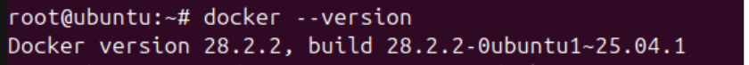

### Figure 2: Historical container download and startup

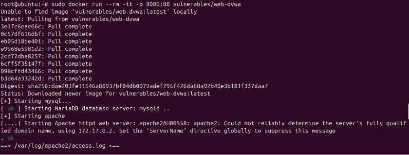

### Figure 3: DVWA login page

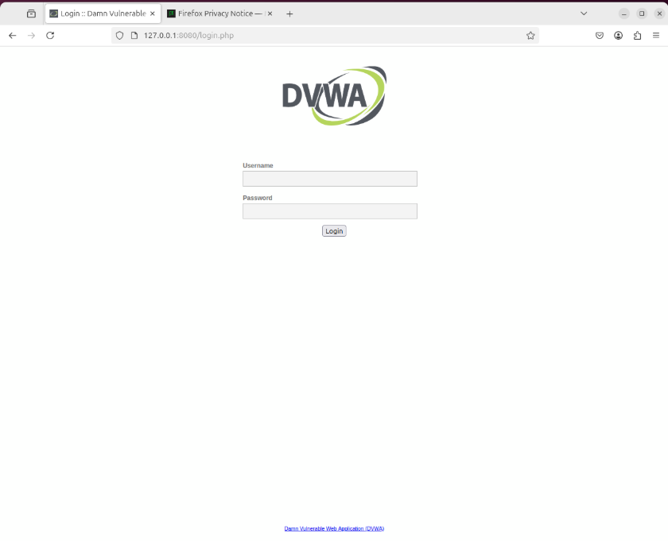

### Figure 4: Database setup checks

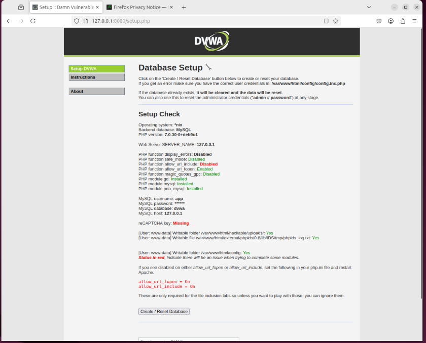

### Figure 5: Database setup and module navigation

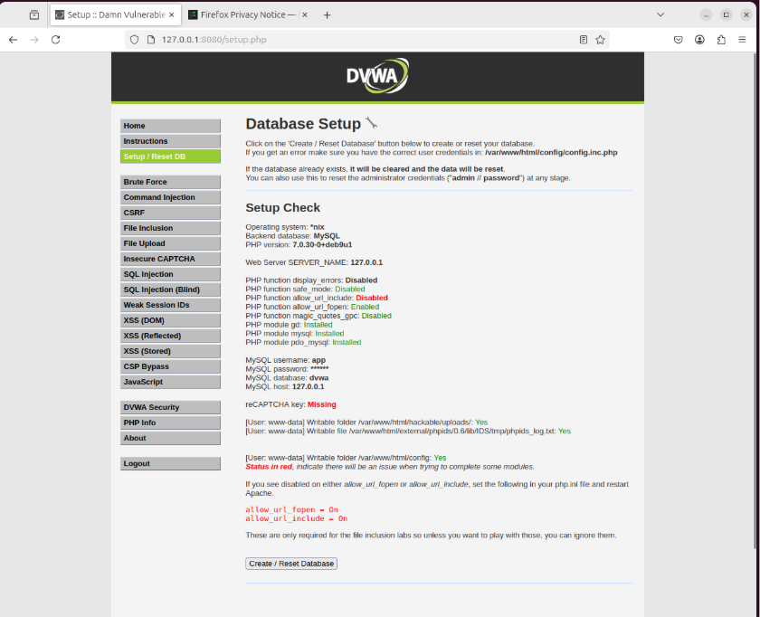

### Figure 6: Low security level selected

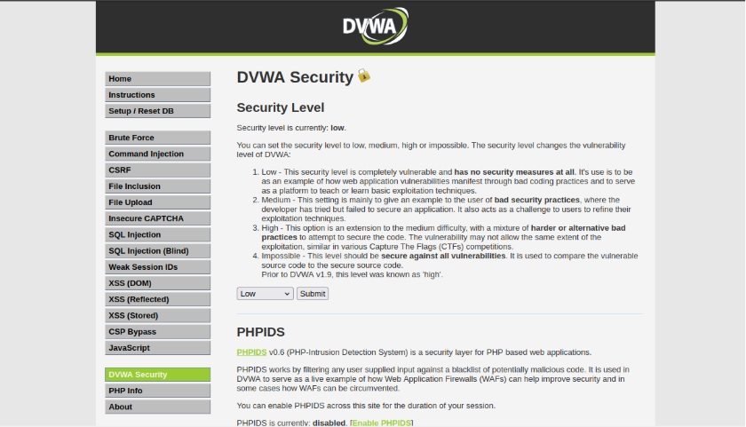

### Figure 7: Ubuntu and Docker network interfaces

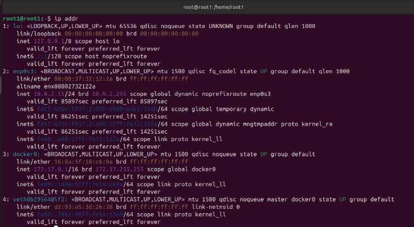

### Figure 8: Running container and published ports

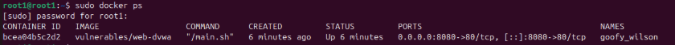

### Figure 9: Local service verification with Nmap

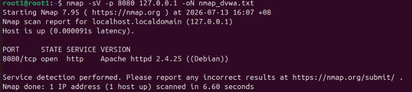

## Authentication assessment

### Figure 60: Failed test login

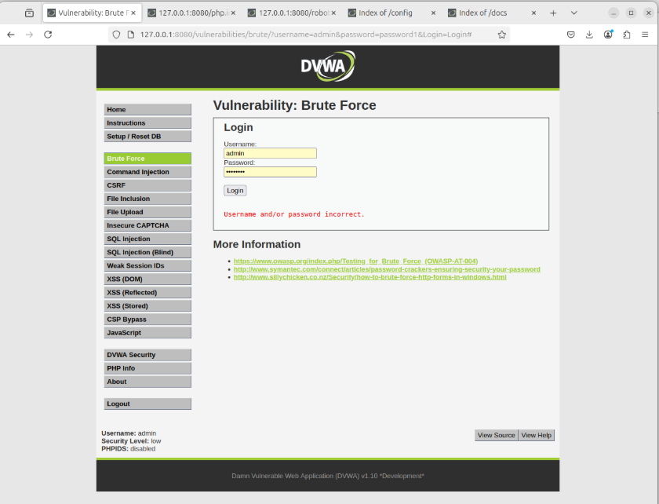

### Figure 61: Protected-area response in the browser

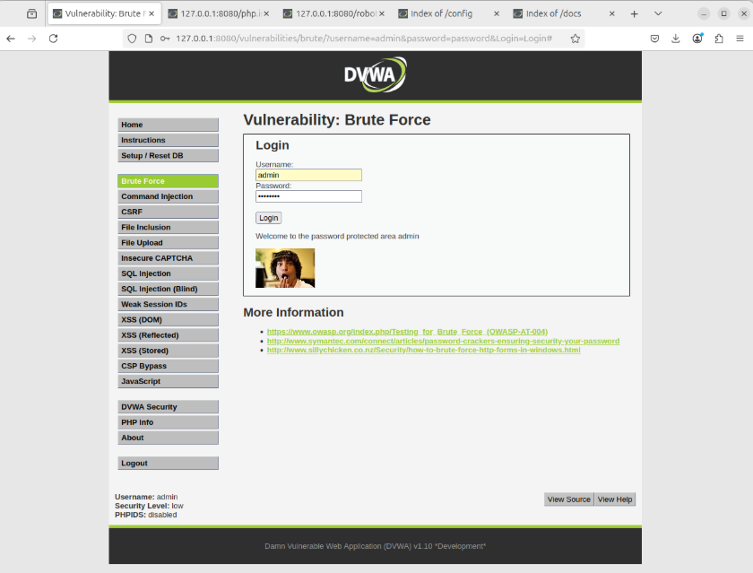

### Figure 62: Browser history of sample login attempts

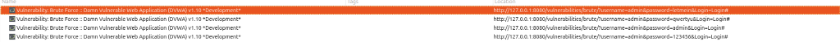

### Figure 63: Failed login with another sample password

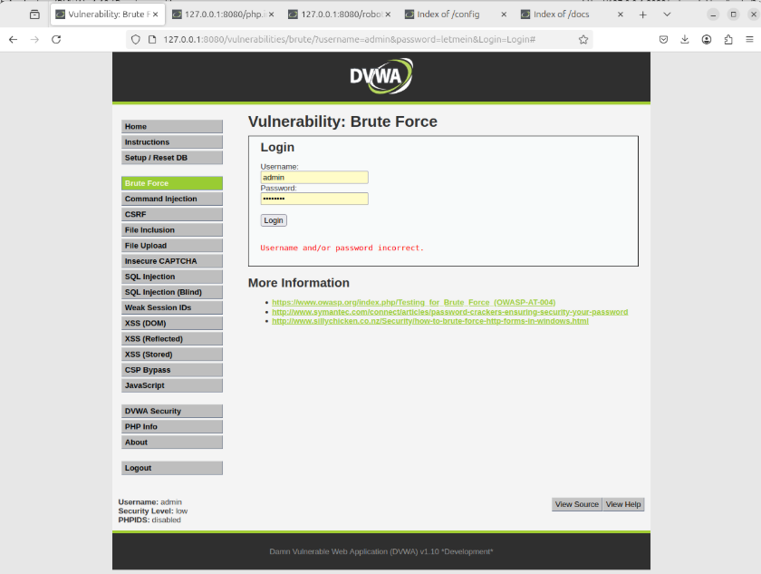

### Figure 64: Intruder password parameter position

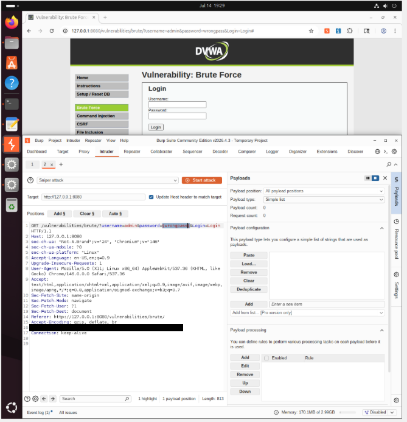

Cookie header redacted with a solid black box.

### Figure 65: Intruder training payload list

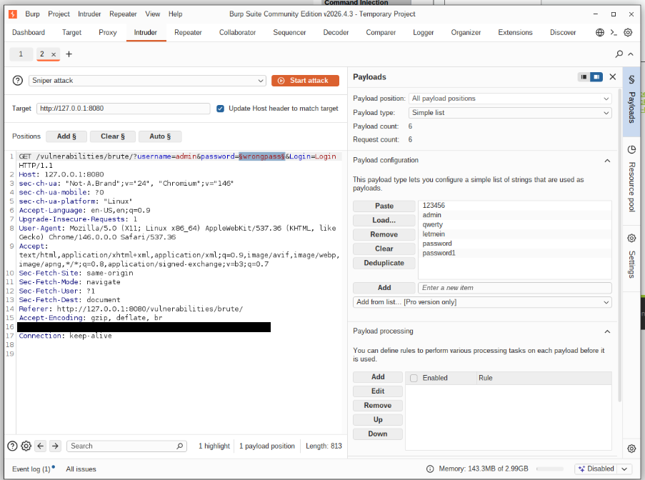

Cookie header redacted with a solid black box.

### Figure 66: Intruder results and response-length comparison

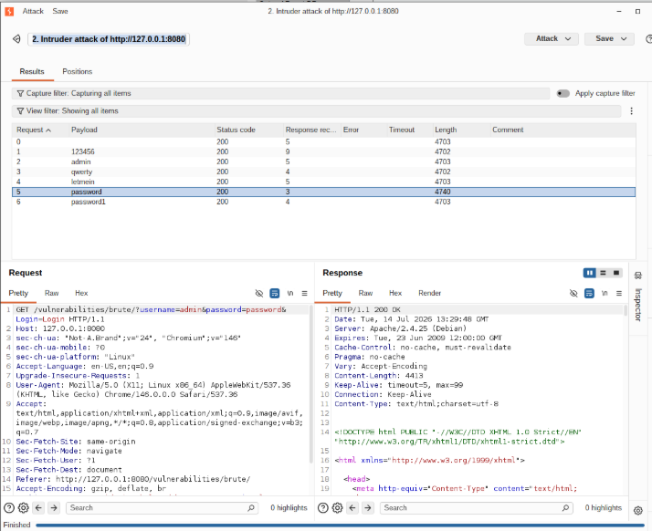

### Figure 67: Protected-area message in the successful response

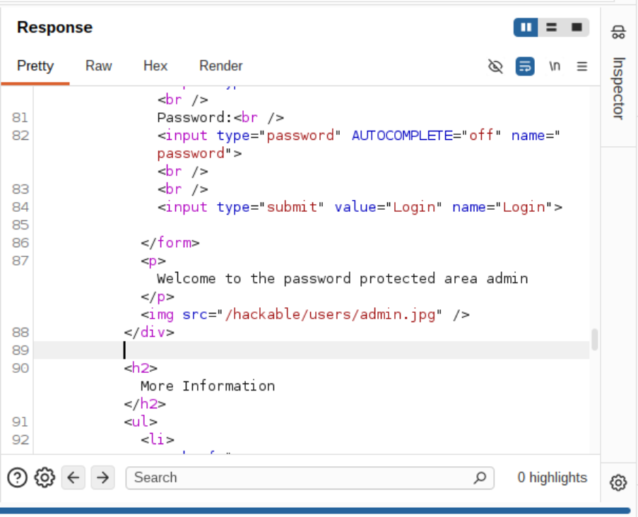

### Figure 68: Failed response and recorded attempt results

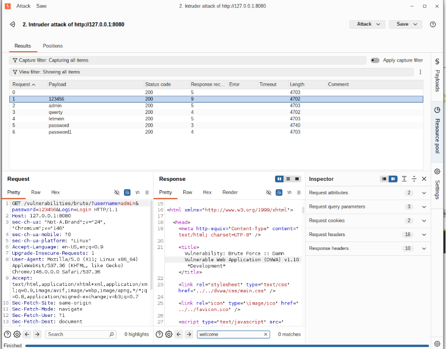

### Figure 69: Successful login confirmation

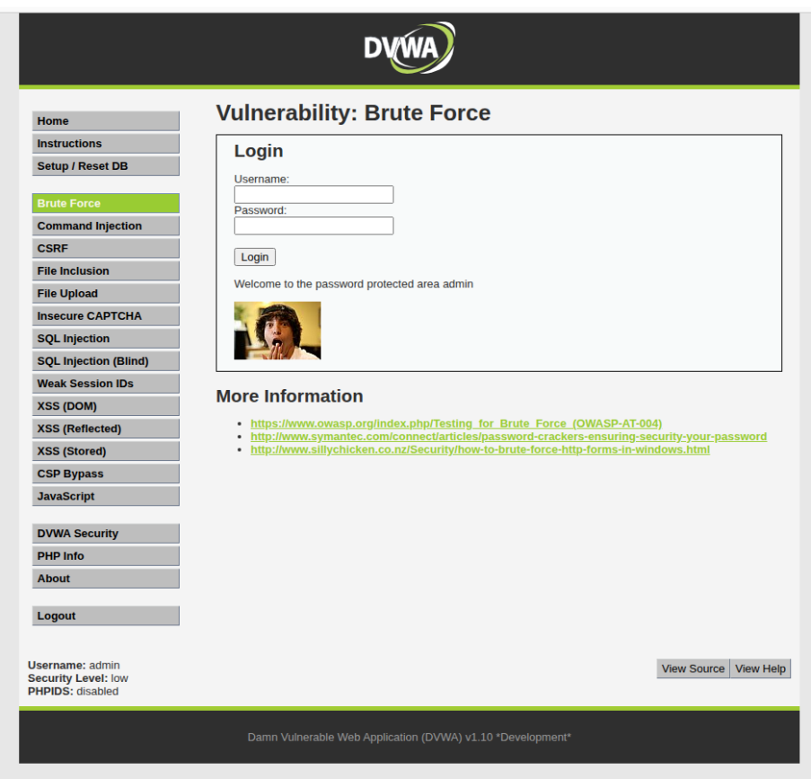

## Publication scope

The full report, cover sheet, student identifiers, contribution marks, raw Burp sessions, request exports, VM disks, and database dumps are excluded. Other vulnerability assessments and the network-design section are outside this individual portfolio selection. See the [case study](CASE_STUDY.md) and [contribution statement](../CONTRIBUTIONS.md).
